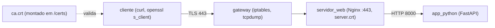

# Ambiente de Rede com Políticas de Segurança — CIC0201

Projeto da disciplina **Segurança Computacional (CIC0201 — UnB)** que implementa uma rede corporativa virtual isolada em Docker, demonstrando comunicação insegura (HTTP), comunicação segura (HTTPS/TLS), autenticação com verificação de integridade (HMAC-SHA256) e filtragem de tráfego com firewall (`iptables`).

## Arquitetura de Rede

O ambiente isola clientes e servidores em duas sub-redes Docker (`internal: true`), forçando todo o tráfego a passar pelo contêiner `gateway`:

| Contêiner | Rede(s) | Endereço IP | Função |
| :--- | :--- | :--- | :--- |
| `cliente` | `rede_clientes` | `172.30.0.10` | Cliente Linux (`curl`, `nc`, `tcpdump`, `openssl`) |
| `gateway` | `rede_clientes` / `rede_servidores` | `172.30.0.2` / `172.31.0.2` | Roteamento, firewall (`iptables`) e captura de pacotes |
| `servidor_web` | `rede_servidores` | `172.31.0.10` | Proxy reverso Nginx (HTTP :80 e HTTPS :443) |
| `app_python` | `rede_servidores` | `172.31.0.20` | API FastAPI com autenticação Bearer e HMAC-SHA256 |

## Como Reproduzir o Ambiente

### Pré-requisitos
- Linux com **Docker** e **Docker Compose** instalados.
- **Wireshark** (no host, para abrir os arquivos `.pcap` salvos em `./capturas`).

### Execução
```bash
# 1. Gerar a CA e o certificado TLS do servidor (Módulo 2). Rodar no host, ANTES do compose
bash nginx/gerar_certificados.sh

# 2. Subir todos os contêineres e redes isoladas
docker compose up -d --build

# 3. Validar que o roteamento passa pelo gateway (172.30.0.2)
docker exec cliente traceroute -n 172.31.0.10
```

> O passo 1 é necessário porque o `servidor_web` monta `nginx/certs/` e o Nginx não inicia o bloco `listen 443 ssl` sem `server.crt` e `server.key`. As chaves privadas (`*.key`) e as CSRs não são versionadas (ver `.gitignore`), então quem clonar o repositório precisa gerar os certificados.

## Módulo 2 — Servidor Web, Criptografia e HTTPS/TLS

O Nginx atende em duas portas, com a mesma aplicação por trás:

- **HTTP :80** continua em texto claro, sem redirecionamento para HTTPS. O Módulo 1 depende dele para demonstrar a captura de credenciais no Wireshark.
- **HTTPS :443** usa TLS com um certificado assinado por uma CA própria do laboratório. A configuração está em [nginx/nginx.conf](nginx/nginx.conf).



### Geração dos certificados
```bash
bash nginx/gerar_certificados.sh           # gera nginx/certs/ (não altera se já existir)
bash nginx/gerar_certificados.sh --force   # apaga e regera a CA e o certificado do servidor
```
O script usa o OpenSSL para criar a CA, gerar a chave e a CSR do servidor, assinar a CSR com a CA e validar a cadeia (`openssl verify -CAfile ca.crt server.crt`). Se os arquivos já existirem, ele pergunta se deve regerar (no terminal) ou encerra sem alterar nada (execução não interativa).

| Arquivo em `nginx/certs/` | Conteúdo | Ignorado pelo git? |
| :--- | :--- | :--- |
| `ca.key` | Chave privada da CA (RSA 4096, modo 600) | Sim |
| `ca.crt` | Certificado autoassinado da CA (`CA:TRUE`) | Não |
| `server.key` | Chave privada do servidor (RSA 2048, modo 600) | Sim |
| `server.csr` | Pedido de assinatura (CN `servidor.local`) | Sim |
| `server.crt` | Certificado do servidor assinado pela CA | Não |
| `ca.srl` | Número de série usado pelo OpenSSL na assinatura | Não |

O `ca.crt` é montado somente leitura no contêiner `cliente` em `/certs`, para o `curl --cacert /certs/ca.crt` e o `openssl s_client -CAfile /certs/ca.crt` validarem a cadeia.

### Parâmetros TLS escolhidos
| Item | Valor |
| :--- | :--- |
| Protocolos | `TLSv1.2` e `TLSv1.3` (TLS 1.0 e 1.1 recusados) |
| Cipher suites (TLS 1.2) | Somente ECDHE com AES-GCM ou ChaCha20-Poly1305 (sigilo perfeito) |
| Preferência de cipher | `ssl_prefer_server_ciphers on` |
| Sessões | `ssl_session_cache shared:SSL:10m`, `ssl_session_timeout 10m` |
| HSTS | `Strict-Transport-Security: max-age=31536000`, apenas no bloco 443 |
| Validade dos certificados | 365 dias (CA e servidor) |
| SAN do servidor | `DNS:servidor.local`, `IP:172.31.0.10` |
| Extensões do servidor | `CA:FALSE`, `keyUsage = digitalSignature, keyEncipherment`, `extendedKeyUsage = serverAuth` |
| Proxy para a API | `http://172.31.0.20:8000`, com `X-Forwarded-Proto https` |

O SAN inclui o IP porque os clientes acessam `https://172.31.0.10` por IP. Sem isso, o `curl` rejeitaria a validação do nome.

### Testes e evidências
```bash
bash testes/testar_modulo2.sh   # executar no host, na raiz do projeto
bash testes/capturar_https.sh   # captura a porta 443 e verifica a ausência de texto claro
```
O `testar_modulo2.sh` roda os comandos dentro do contêiner `cliente` e grava a saída em `testes/evidencia_modulo2_tls.txt`:

| Teste | O que verifica | Resultado esperado |
| :-: | :--- | :--- |
| 1 | `curl --cacert /certs/ca.crt https://172.31.0.10/` | Handshake OK, `SSL certificate verify ok`, HTTP 200 |
| 2 | `curl` sem `--cacert` | Falha na validação (`unable to get local issuer certificate`), o que prova que a cadeia é checada |
| 3 | `curl -k` | Conecta sem validar a identidade (apenas contraste) |
| 4 | `openssl s_client -CAfile /certs/ca.crt -servername servidor.local` | Protocolo e cipher negociados, cadeia, `Verify return code: 0 (ok)` e SAN com o IP e o DNS |
| 5 | Cliente limitado a TLS 1.1 | Servidor recusa. TLS 1.2 continua funcionando |
| 6 | `POST /login` e `GET /protegido` por HTTPS | A aplicação funciona sob TLS (token obtido, 200 com token e 401/403 sem token) |
| 7 | `GET http://172.31.0.10/` | HTTP :80 segue disponível, sem redirecionamento |

O `capturar_https.sh` gera `capturas/modulo2_https.pcap`. No Wireshark, o filtro `tls.handshake` mostra o Client Hello, o Server Hello e o certificado, e o conteúdo da aplicação aparece cifrado (`Admin@2026` e `Authorization:` não são visíveis, ao contrário da captura HTTP do Módulo 1).

Como o firewall do Módulo 4 já libera `TCP 443` dos clientes para `172.31.0.10`, o teste de HTTPS do `testar_modulo4.sh` passa de `RECUSADA` (sem serviço na porta) para sucesso quando o Nginx está com TLS ativo.

## Módulo 4 — Firewall, Controle de Acesso e Monitoramento

O contêiner `gateway` aplica a política abaixo automaticamente ao subir, por meio do [gateway/entrypoint.sh](gateway/entrypoint.sh) e do [gateway/firewall.sh](gateway/firewall.sh). Os bloqueios são registrados via `NFLOG` + `ulogd2` em `logs/firewall.log`.

### Política de segurança (empresa hipotética)
1. **Negar por padrão**: tudo que não for explicitamente liberado é descartado (`INPUT` e `FORWARD` com política `DROP`).
2. **Ponto único de entrada**: clientes acessam a aplicação somente pelo proxy Nginx (`172.31.0.10`), nas portas 80 e 443.
3. **Backend protegido**: o acesso direto à API (`172.31.0.20:8000`) é proibido e registrado como tentativa de contornar o proxy.
4. **Servidores não iniciam conexões** com a rede de clientes, o que impede movimento lateral e *reverse shell*.
5. **Diagnóstico controlado**: ping de clientes para servidores e para o gateway é liberado, com limite de taxa.
6. **Gateway sem serviços de gerência** expostos (SSH etc.).
7. **Toda negação é registrada**, com prefixo identificável e limite de 30 registros/min.

### Tabela de regras
| # | Chain | Origem | Destino | Proto/Porta | Ação | Prefixo do log |
| :- | :- | :- | :- | :- | :- | :- |
| 1 | FORWARD | qualquer | qualquer | estado INVALID | LOG + DROP | `FW-INVALID` |
| 2 | FORWARD | qualquer | qualquer | ESTABLISHED,RELATED | ACCEPT | – |
| 3 | FORWARD | 172.30.0.0/24 | 172.31.0.10 | TCP 80 | ACCEPT | – |
| 4 | FORWARD | 172.30.0.0/24 | 172.31.0.10 | TCP 443 | ACCEPT | – |
| 5 | FORWARD | 172.30.0.0/24 | 172.31.0.0/24 | ICMP echo-request (5/s) | ACCEPT | – |
| 6 | FORWARD | 172.30.0.0/24 | 172.31.0.20 | TCP 8000 | LOG + DROP | `FW-BYPASS-PROXY` |
| 7 | FORWARD | 172.31.0.0/24 | 172.30.0.0/24 | qualquer (nova conexão) | LOG + DROP | `FW-SRV-TO-CLI` |
| 8 | FORWARD | qualquer | qualquer | demais | LOG + DROP | `FW-FWD-DROP` |
| 9 | INPUT | lo / ESTABLISHED / ICMP das redes internas | gateway | – | ACCEPT | – |
| 10 | INPUT | qualquer | gateway | demais | LOG + DROP | `FW-IN-DROP` |
| – | OUTPUT | gateway | qualquer | – | ACCEPT | – |

### Comandos úteis
```bash
docker exec gateway sh /firewall.sh status    # regras com contadores
docker exec gateway sh /firewall.sh limpar    # desliga a filtragem (cenário sem proteção)
docker exec gateway sh /firewall.sh aplicar   # religa a política
tail -f logs/firewall.log                     # bloqueios em tempo real
```

### Testes e evidências
```bash
bash testes/testar_modulo4.sh   # executar no host, na raiz do projeto
```
O script compara o cenário **sem firewall** com o cenário **com firewall** e gera:
- `testes/evidencia_modulo4.txt`: resultado de cada teste, contadores das regras e registros de bloqueio;
- `capturas/modulo4_firewall.pcap`: captura no gateway. No Wireshark, com o filtro `tcp.flags.syn==1`, os SYNs bloqueados chegam ao gateway, são retransmitidos e nunca recebem resposta (nem RST).

Na saída dos testes, `RECUSADA` significa que o firewall deixou o pacote passar, mas não há serviço na porta (o destino respondeu RST). `BLOQUEADA` significa que o pacote foi descartado pelo firewall (timeout).

**Limitação:** o tráfego Nginx → API (`172.31.0.10` → `172.31.0.20`) fica dentro da mesma sub-rede e não passa pelo gateway, por isso não é filtrado por ele.
